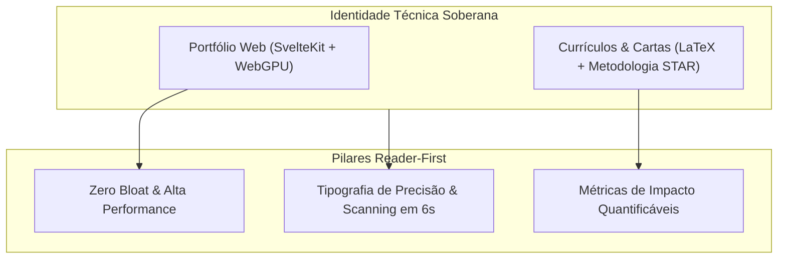

# 🥋 Developer Identity Crafting — Runbook Cognitivo

Este runbook orienta desenvolvedores e agentes de IA na manutenção, expansão e refinamento da identidade profissional técnica soberana de Gabriel Frigo, integrando o portfólio web de alta performance ([gabrielfrigo.dev.br](https://gabrielfrigo.dev.br)) e o ecossistema de currículos e cartas de candidatura em LaTeX.

---

## 🏛️ Arquitetura Unificada de Identidade

A identidade técnica opera sob a **Filosofia Anti-Inchaço**, estética hacker refinada e princípios Reader-First:

---

## 🌐 1. Engenharia do Portfólio Web Estático

O website oficial é construído em SvelteKit com compilação 100% estática:

- **Zero Runtime Bloat:** Compilação puramente estática via `@sveltejs/adapter-static`. Todo endpoint ou rota define `export const prerender = true;`.
- **Estética Terminal & Hacker:** Dark mode refinado (`#090d13`), fontes monoespaçadas (`Fira Code`), realces em tons de terminal (verde `#7ee787`, azul `#58a6ff`, coral `#ff7b72`).
- **SVG Inline Nativo:** Todo ícone de controle ou UI deve ser SVG inline nativo (`viewBox="0 0 24 24"`). Proibido emojis soltos ou caracteres UTF-8 como controles de UI para evitar jitter entre sistemas operacionais.
- **WebGPU de Vanguarda (2025/2026):** Catálogo de IA no navegador restrito a modelos recentes (Gemma 3, Qwen 3.5, Phi-4, DeepSeek R1) com quantização `q4f16_1` e contexto adaptativo para mobile.
- **Clean Code Declarativo:** Arquivos de código (`.svelte`, `.js`, `.css`, `Makefile`) não devem ter comentários narrativos. A lógica deve ser autoevidente.

### Comandos de Operação (Portfolio):

- `make dev` — Inicia servidor de desenvolvimento Vite local.
- `make build` — Compila artefatos estáticos na pasta `build/`.
- `make format` & `make lint` — Formatação e validação com Prettier.

---

## 📄 2. Tailoring de Currículos e Cartas (LaTeX)

A adaptação de candidaturas personalizadas segue rigor técnico e parametrização declarativa:

1. **Seleção de Template:** Base em `template/resume-{pt,en}.tex` ou `template/letter-{pt,en}.tex`.
2. **Destino Canônico:** `companies/<empresa_slug>/<cargo_slug>-<ano>.tex`.
3. **Parametrização:** Configurar macros `\newcommand{\targetRole}{...}` e `\newcommand{\targetCompany}{...}`.
4. **Metodologia STAR com Métricas:**
    - Descrever experiências com **Situação, Tarefa, Ação e Resultado**.
    - Resultados DEVEM conter métricas quantificáveis concretas (latência, throughput, linhas de código, economia de recursos).
5. **Invariante de Página Única:** O currículo deve caber estritamente em **1 página**.

### Comandos de Operação (Resumes):

- `make companies` — Compila PDFs das empresas em `companies/<empresa>/`.
- `make readme` — Atualiza tabela de candidaturas no `README.md`.
- `make check` — Valida integridade e compilação de todos os documentos.

---

## 🎯 3. Princípios Reader-First & Tipografia

- **Scanning Imediato:** Recrutadores técnicos e líderes de engenharia avaliam perfis em 6 segundos. A hierarquia visual deve guiar o olhar diretamente para tecnologias de ponta, métricas de impacto e links soberanos.
- **Eliminação de Jargões Vazios:** Banir adjetivos genéricos ("proativo", "apaixonado por tecnologia"). Apresentar fatos técnicos: arquitetura de sistemas, contribuições open-source, invariantes POSIX e código perto do metal.
- **Consistência Tipográfica:** Equilíbrio de espaçamento vertical, micro-tipografia rigorosa e paridade visual entre o website estático e os documentos PDF impressos/exportados.
